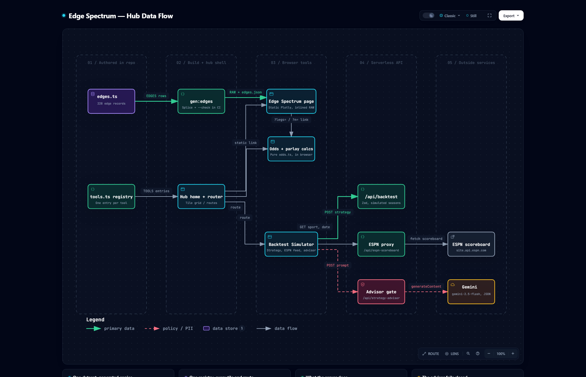

<h1 align="center">🧭 Diagrams</h1>

<p align="center">
  <em>How Edge Spectrum's dataset, registry and serverless functions fit together, drawn from the code and checked against it.</em>
</p>

<p align="center">
  
  
  <a href="../README.md"></a>
</p>

---

## 🔌 Hub data flow

[](hub-data-flow.html)

How the hub is put together: the 228 edge records are authored once in `site/src/data/edges.ts`
and `gen:edges` splices them into the static Spectrum page; the `tools.ts` registry draws every tile
on the home page and every route. The odds and parlay calculators run entirely in the browser (the
Spectrum inspector opens them pre-filled by query string). The Backtest Simulator is the one tool
that calls the server: `/api/backtest` (Zod-validated, synthetic seasons), the ESPN scoreboard proxy,
and the Gemini advisor, which fails closed unless the deployment is in `full` mode with a passcode
session. Below the map, four cards cover the generated dataset, the registry, what the server does,
and the advisor gate.

**See it on the [homepage](https://edge-spectrum.ai-automation-tools.dev/#sec-flow)**, or open the interactive version: [`hub-data-flow.html`](hub-data-flow.html) in a browser
from a clone, or [render it from GitHub](https://raw.githack.com/ai-automation-tools/edge-spectrum/main/Docs/diagrams/hub-data-flow.html).
Each node links to the exact lines it describes at the pinned commit, and the viewer adds route
tracing, search, light/dark, and SVG/PNG export.

## 📂 Files

| File | What it is | Edit it? |
|:---|:---|:---|
| [`hub-data-flow.json`](hub-data-flow.json) | The source: stages, nodes, flows, cards, and the code each node cites | **Yes, this is the only file you edit** |
| `hub-data-flow.html` · `.png` | Generated: the interactive diagram, which the homepage embeds live, and a static PNG snapshot | Never; rebuild |
| `site/public/diagram/hub-data-flow.html` · `.png` | Copies the build writes for the homepage; Vite ships `public/` into `dist/`, so the page embeds them same-origin at `/diagram/`. `--check` flags a copy that differs | Never; rebuild |
| `hub-data-flow.delivery.json` · `.sources.lock.json` | Build receipt, and the git blob of every cited file at the pinned commit | Never; rebuild |
| [`../../scripts/build-diagram.mjs`](../../scripts/build-diagram.mjs) | Builds the diagram and checks it for drift | Only to change how it builds or checks |

## 🔁 Keeping it current

Every node cites code by path and line range, pinned to the commit in `meta.repository.revision`.
The cited files are `site/src/data/edges.ts`, `site/src/tools.ts`,
`site/scripts/generate-edge-artifacts.ts`, `site/src/pages/Home.tsx`, `site/src/App.tsx`,
`site/public/spectrum/index.html`, `site/src/odds.ts`, `site/src/calcUrl.ts`,
`site/src/BacktesterApp.tsx`, `site/src/components/{EspnFeed,AiAdvisor}.tsx`, the three
`site/api/` functions behind it, and `site/src/server/{backtest,strategySchema,espn,auth,deployment,advisor}.ts`.
When one changes, the diagram may describe logic that moved or no longer exists, so it counts as
stale until someone has re-read that code. Two of them change often for their own reasons
(`edges.ts` with every new record, `Home.tsx` with homepage copy), so expect the check to name them.

| When | What catches it |
|:---|:---|
| **Every push and PR** | CI's *Diagram drift* step runs `--hook` and turns each finding into a warning annotation. It never fails the build |
| **Any time** | `node scripts/build-diagram.mjs --check` exits 1 and names the stale files |
| **Weekly** | The repo owner's doc drift check runs `--check` on the local clone, and the org upkeep job rebuilds a stale diagram by PR |

To bring it up to date:

1. Commit the code change first. Evidence is pinned to committed bytes, never to working-tree edits.
2. Re-read each changed file the check named. In `hub-data-flow.json`, fix the line ranges in
   `sources` (at most three per node), and any label, sublabel, flow or card the change made
   untrue. A new route tool that calls the server gets its function node in the *Serverless API*
   column; a browser-only tool joins the calculators. Keep the existing ids.
3. Rebuild, re-pinning to the commit you just read:

   ```bash
   node scripts/build-diagram.mjs --pin-head
   ```

4. Commit the JSON, the generated files and the `site/public/diagram/` copies together, with a [CHANGELOG](../CHANGELOG.md) line.

Building needs Node 18+, Chrome, and the [Archify](https://github.com/tt-a1i/archify) skill
(default path `~/.claude/skills/archify/bin/archify.mjs`; pass `--archify <path>` to point
elsewhere). The check needs only git. A failed build exits 1 and leaves the last good HTML and
PNG in place; the reason is in `Docs/diagrams/.build/hub-data-flow.finalize-summary.json`.

---

<p align="center">
  <sub>← <a href="../README.md">Documentation home</a> · <a href="../../README.md">Edge Spectrum</a></sub>
</p>
