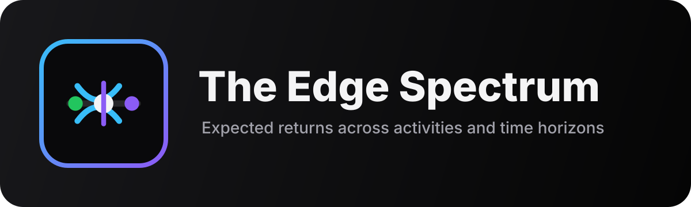

<a id="readme-top"></a>

# Edge Spectrum 🟢

<p align="center">
  <a href="https://edge-spectrum.ai-automation-tools.dev">
    
  </a>
</p>

<p align="center">
  <em>A unified multi-tool hub for sports betting, investing, gambling, and odds analysis.<br>Compare expected returns across time horizons, backtest sports wagering strategies over 26 simulated seasons, and analyze mathematical edges.</em>
</p>

<p align="center">
  <a href="docs/README.md"><strong>Explore the docs »</strong></a>
</p>

<p align="center">
  <a href="https://edge-spectrum.ai-automation-tools.dev">Try the Public Demo</a>
  ·
  <a href="https://github.com/ai-automation-tools/edge-spectrum/issues">Report Bug</a>
  ·
  <a href="https://github.com/ai-automation-tools/edge-spectrum/issues">Request Feature</a>
</p>

<p align="center">
  <a href="https://edge-spectrum.ai-automation-tools.dev"></a>
  
  <a href="docs/ROADMAP.md"></a>
  <a href="https://github.com/ai-automation-tools/edge-spectrum/actions/workflows/ci.yml"></a>
</p>

<p align="center">
  
  
  
  
  
</p>

---

## 🚀 Overview

**Edge Spectrum** is an interactive playground for exploring mathematical edges. It brings together four analytical applications:

1. **The Edge Spectrum Expected-Return Visualizer** (`/spectrum/`): Compares **more than 230 financial, investing, trading, and gambling activities** over **7 time horizons** (Single Event to 10 Years), standardized using the **DU/CED framework**. Return on capital is the primary axis and is floored at −100%; the unbounded turnover cost gets its own axis so the two are never compared as if they were the same quantity.
2. **The Backtest Simulator** (`/backtester`): Backtests sports wagering strategies across **26 simulated seasons of MLB, NFL, NHL, and NBA games** (2000–2025), providing ROI diagnostics, equity curves, live ESPN scores, and an **AI Strategy Advisor** powered by Gemini.
3. **Odds Converter & No-Vig Calculator** (`/odds`): Converts American, decimal, fractional and implied odds, and strips bookmaker margin from any multi-way market via **multiplicative, power, or Shin** de-vigging.
4. **Parlay & SGP Hold Calculator** (`/parlay`): De-vigs each leg, multiplies out the true joint probability, and compares it with the book's parlay payout to expose how the margin compounds per leg.
5. **Kelly & Bankroll Sizing Calculator** (`/kelly`): Sizes one bet, or several settled together, from the price and your win probability at full or fractional Kelly, with growth per bet and the odds of a halved bankroll.

---

## 🛠️ Applications & Features

### 1. The Edge Spectrum Expected-Return Visualizer
Served as a static page at `/spectrum/index.html` (internally routes to `public/spectrum/index.html`).

- **15 asset and bet categories**, from index funds to lottery tickets. The generated [`data/edge_dataset.md`](data/edge_dataset.md) lists every record by category.
- **The dataset is downloadable**: [`/spectrum/edges.csv`](https://edge-spectrum.ai-automation-tools.dev/spectrum/edges.csv), with its schema, version and licence in [`datapackage.json`](https://edge-spectrum.ai-automation-tools.dev/spectrum/datapackage.json), and attached to each `dataset-*` [release](https://github.com/ai-automation-tools/edge-spectrum/releases). The data is [CC BY 4.0](https://creativecommons.org/licenses/by/4.0/); cite "Edge Spectrum" and keep each record's source.
- **Universal DU/CED Framework:** Standardized expected returns via:
  $$\text{Expected Turnover Cost} = \text{Decision Units (DU)} \times \text{Capital Exposure per Decision (CED)} \times \text{Edge}$$
- **Three named measures, never mixed on one axis:**
  - **Return on Capital** *(primary)* — what happens to the one bankroll you brought. Held assets compound; wagering activities accrue their flat-stake loss and stop at **−100%**, because a bankroll cannot lose more than itself.
  - **Expected Turnover Cost** *(secondary axis, wagering activities only)* — the DU/CED product above: cumulative expected loss as a multiple of the starting bankroll, deliberately **unbounded**, because it assumes you keep reloading.
  - **Ruin Point** — decisions until the bankroll is expected to reach $0 (years to −90% for a losing held asset).
- **Interactive Controls:** Toggle any combination of categories, switch measure (On Capital / Turnover Cost), adjust time horizons (Single Event to 10 Years), switch overlays (Raw Returns, Fee-Adjusted, After-Tax).
- **Ruin Point Overlay** *(on by default)*: a dotted −100% floor line on the primary chart, an ✕ per activity whose bankroll is gone before the horizon ends, a **Ruined By Horizon** counter, and per-activity decisions-to-$0 and time-to-ruin in the tooltip.
- **Addiction Risk Scoring:** Color-coded border alerts based on feedback loops and documentation of problem behavior.
- **Where do I sit?** Enter your own activity and stake, and the page places it on the chart and states the expected outcome in dollars.

### 2. The Sports Wagering Backtester
Served inside the SPA React shell at `/backtester`.

- **26 Synthetic Seasons:** Calibrated power-rating simulation for MLB, NFL, NHL, and NBA (2000–2025) with empirical distribution-based market pricing.
- **Custom Strategy Builder:** Define wager filters based on home/away status, bookmaker odds (favorites/underdogs), and custom edge margins.
- **Position Sizing Models:** Standard flat betting vs. Kelly Criterion sizing (Full/Fractional).
- **Interactive Reports:** Analyze cumulative profit curves, win rates, ROI, Kelly diagnostics, and drawdowns.
- **Statistical Significance:** Every run reports the breakeven win rate its own prices demand, a 95% Wilson interval on the hit rate, and an exact one-tailed binomial p-value — with a small-sample warning under 250 wagers — so a lucky streak is labelled as noise rather than an edge.
- **Shareable Links:** The active strategy lives in the URL (`/backtester?sport=NBA&betType=spread&side=home&…`), so any run can be bookmarked or sent with **Copy link**; a stale or hand-edited link falls back to defaults field by field instead of erroring.
- **Live Scoreboard integration:** Pulls real-time ESPN scoreboard updates.
- **Gemini AI Strategy Advisor (your full instance):** Iterates on backtest results to suggest portfolio optimizations, staking alterations, or parameter tuning.

### 3. ESPN Line Capture (scheduled, local)
A collector that builds your own archive of real sportsbook lines for closing-line-value analysis
(roadmap Actions 5.1 and 5.2). Each run snapshots ESPN's public scoreboard for NFL, NBA, MLB and NHL
and appends one JSON line per game to `<folder>/<SPORT>/<day>.jsonl`: spread and its prices, total,
moneyline, scores, and a `linePhase` of `open`, `midday` or `close`. Files are only ever appended to,
there are no keys, and nothing leaves your machine.

> [!NOTE]
> The collector and the live scoreboard read an **unofficial, undocumented ESPN endpoint**. Edge Spectrum
> is not affiliated with ESPN. If you run the collector you are responsible for following ESPN's terms of
> use: keep it to personal, low-volume use (the default is one request per league every three hours) and do
> not republish what you capture. This project does not publish captured lines.

```bash
cd site && npm run capture:lines -- --out ~/edge-lines
```

Schedule it with [Cronsole](https://cronsole.ai-automation-tools.dev/): download the
[ESPN Line Capture template](https://cronsole.ai-automation-tools.dev/#/t/edge-spectrum-line-capture)
(or the [Edge Spectrum pack](https://cronsole.ai-automation-tools.dev/#/collection/edge-spectrum)) and
import it under **Templates → Import**. It runs every 3 hours by default. A game gets one `open`
record even when ESPN lists it on several days' boards, and a damaged line in a file is skipped with a
warning. How `linePhase` is decided
is in [data-architecture.md](docs/data-architecture.md#a-append-only-scoreboard-line-snapshots).

**Daily digest.** Once captures are running, the
[Daily Line Movement Digest template](https://cronsole.ai-automation-tools.dev/#/t/edge-spectrum-line-digest)
reads yesterday's files and writes `<folder>/digests/<day>.md`: each game's opening and closing spread,
total and home moneyline, the final score, the biggest spread moves, and every game missing an opening or
closing capture. It runs daily at 12:30 UTC and fails if the day has no capture file at all.

```bash
cd site && npm run digest:lines -- --archive ~/edge-lines [--date 2026-11-10]
```

---

## 🏗️ Repository Architecture

```
edge-spectrum/
├── site/                  # ← THE WEB APP (Vercel Root Directory = site)
│   ├── api/               # Vercel serverless functions (backtest, ESPN scoreboard, advisor, advisor auth)
│   ├── public/
│   │   ├── favicon.svg    # The served app icon
│   │   └── spectrum/      # The Edge Spectrum static Plotly visualization page
│   ├── src/
│   │   ├── components/    # Backtester UI components (AiAdvisor, StrategyBuilder, ProfitChart, etc.)
│   │   ├── pages/
│   │   │   └── Home.tsx   # Landing page (dashboard tile grid mapping over tools.ts)
│   │   ├── server/        # Shared backend engines (backtest, ESPN score, Gemini prompt engines)
│   │   ├── data/edges.ts  # The Dataset — SINGLE SOURCE OF TRUTH for every edge record
│   │   ├── App.tsx        # Main router shell & top-nav bar
│   │   ├── main.tsx       # React bootstrap
│   │   └── tools.ts       # The Registry — SINGLE SOURCE OF TRUTH for all tools
│   ├── scripts/           # Guards & generators (the checks `npm run verify` runs; see docs/README.md)
│   ├── server.ts          # Express local dev server (proxies/runs Vite + serverless local engines)
│   ├── package.json       # Scripts & node dependencies
│   └── vercel.json        # Vercel configuration (SPA routing overrides & API serverless mappings)
├── docs/                  # In-depth logs, standardized analysis, and future ideas
│   └── diagrams/          # Code-pinned Archify diagram of the hub (shown on the homepage)
├── scripts/               # build-diagram.mjs: builds and drift-checks docs/diagrams/ (docs tooling, not shipped)
├── data/                  # edge_dataset.md (generated from edges.ts) + frozen legacy catalogs
└── images/                # Logos, icons, screenshots, and favicon.svg (archived copy of the app icon)
```

> **Note:** everything the site needs lives under `site/`; the repo root holds only docs, archives and
> the diagram builder. The [hub data-flow diagram](docs/diagrams/README.md) shows how the pieces connect;
> it lives on the [homepage](https://edge-spectrum.ai-automation-tools.dev/#sec-flow), interactive and linked to the code.
> Run all app commands (`npm …`, `vercel …`) from inside `site/`.

---

## 🚀 Try the demo or create your own site

The [public demo](https://edge-spectrum.ai-automation-tools.dev) includes the interactive Spectrum,
odds and parlay calculators, synthetic backtester, and live scoreboard. Its AI advisor
shows **clearly labeled sample responses**, with no Gemini calls and no visitor API keys.

The full application is included in this repository under [Apache-2.0](LICENSE). The dataset (`edges.csv` and its copies) is [CC BY 4.0](https://creativecommons.org/licenses/by/4.0/).
[Create your own site](https://edge-spectrum.ai-automation-tools.dev/setup) to deploy a copy to
Vercel with your own Gemini key, private advisor passcode, and live AI responses.
Use **Use this template** on GitHub to create a complete copy you can customize.

| Capability | Public demo | Your full instance |
| --- | --- | --- |
| Spectrum, odds, parlay & Kelly tools | Interactive | Full access |
| 26-season synthetic backtester | Interactive | Full access |
| ESPN scoreboard | Live feed | Live feed |
| Gemini advisor | Written samples | Live, passcode protected |
| Source and branding | Browse | Customize |

See the [self-hosting guide](docs/self-hosting.md) for deployment steps and environment settings.
The server defaults to demo mode; only `EDGE_SPECTRUM_MODE=full` enables live AI.

### Local development

Use Node.js 22 or 24:

```sh
git clone https://github.com/ai-automation-tools/edge-spectrum.git
cd edge-spectrum/site
npm ci
```

Copy `.env.example` to `.env`, then run `npm run dev` and open `http://localhost:3001`.
The default demo needs no API key. For full mode, fill in the variables documented
in the [setup guide](docs/self-hosting.md); the passcode and the signing secret are both required. Never commit your `.env` file.

```sh
npm run verify   # every check CI runs, in order; the first run needs `npx playwright install chromium`
```

What each check holds is listed in [docs/README.md](docs/README.md#-testing--validation-invariants).

---

## 🔌 Adding a New Tool

To add a new tool to the Edge Spectrum hub, follow the **three-step recipe**:

1. **Register the Tool:** Add an entry to the `TOOLS` array in [tools.ts](site/src/tools.ts):
   ```typescript
   {
     slug: 'my-new-tool',
     title: 'My Custom Tool',
     blurb: 'Brief description of the tool...',
     icon: MyIconName,
     href: '/my-new-tool', // or direct static path
     kind: 'route',        // 'route' | 'static' | 'external'
     status: 'live',       // 'live' | 'wip' | 'soon'
     accent: 'violet',     // Color scheme name
     tag: 'Utility'
   }
   ```
2. **Mount the Code:**
   - **`route` kind:** Build the page component under `site/src/pages/MyNewTool.tsx` and add it to [App.tsx](site/src/App.tsx) as a `lazy()` import with its `<Route>`. A new route is also listed in three more places, or it is a 404 in production while it works in dev: the rewrite in `site/vercel.json`, `CLIENT_ROUTES` in `site/server.ts` and `site/public/sitemap.xml`.
   - **`static` kind:** Put your HTML/CSS/JS folder inside `site/public/my-new-tool/` and link its `href` to `/my-new-tool/index.html`.
   - **`external` kind:** Set `href` to the external destination URL (it will open in a new tab).
3. **Accent Setup:** Ensure the selected `accent` name exists inside the Tailwind literal mapping inside [Home.tsx](site/src/pages/Home.tsx) so the JIT compiler generates the appropriate borders and glows.

---

## 🚀 Deployment

The public demo is hosted on **Vercel** (`edge-spectrum.ai-automation-tools.dev`). The Vercel project's **Root Directory is set to `site`**, so it builds from the app subdirectory.

- **Demo mode:** `EDGE_SPECTRUM_MODE=demo`; no Gemini credentials are needed.
- **Production branch:** `main` (automatically deployed on push/merge).
- **One deploy path:** merging a pull request into `main`. Every pull request gets a Vercel preview to check first.
- **After a deploy:** the *Registry drift* workflow smoke-checks the live site (routes, 404s, the dataset, a backtest, and that the demo is still in demo mode). It also runs daily. Run it yourself with `node site/scripts/check-live.mjs [url]`.
- **Rolling back:** [three steps](docs/self-hosting.md#rolling-back).
- **Unknown paths are a 404**, not the home page: only the app's own routes are rewritten to the SPA.

---

## ⚠️ Disclaimer

Expected returns are modeled averages derived from historical market data, bookmaker averages, and retail-trader statistics. Individual results vary drastically due to short-term variance.

> [!CAUTION]
> **For educational purposes only.** This tool does not constitute investment or gambling advice.

Gambling is for adults only (18+ or 21+ depending on where you live). If gambling is causing you a problem, free and confidential help is available: **1-800-GAMBLER** (US), **0808 8020 133** (UK National Gambling Helpline), **1800 858 858** (Gambling Help, Australia), or [GamblingTherapy.org](https://www.gamblingtherapy.org/) worldwide. Every page of the hub carries the same notice in its footer.

---

<p align="center">
  <sub>Managed by ai-automation-tools · Standalone HTML/CSS/Plotly viz and React/Vite dashboard</sub><br>
  <sub><b>GAMBLING: LINEAR DECAY · INVESTING: COMPOUND APPRECIATION</b></sub>
</p>
